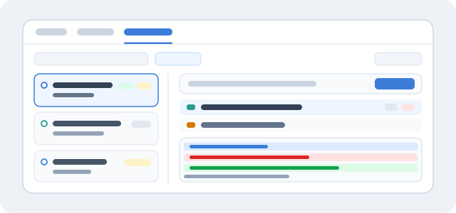

<div align="center">
  
  <h1>DSH RepoRadar</h1>
  <p>
    <strong>IntelliJ IDEA-style multi-repository Git workbench plugin for DeepSeek Harness (DSH)</strong>
  </p>
  <p>
    <a href="./README.md">English</a> · <a href="./README.zh-CN.md">简体中文</a> ·
    <a href="https://github.com/xxll569/dsh-repo-radar/releases">Releases</a> ·
    <a href="https://github.com/xxll569/dsh-repo-radar/issues">Issues</a>
  </p>
  <p>
    
    
    
  </p>
</div>

---

By default, **DeepSeek Harness (DSH)** only detects `.git` at the workspace root. When your real repositories sit in nested subdirectories (e.g., `code/backend/`, `code/frontend/`, `refs/sdk/`) or your workspace contains multiple services, submodules, and worktrees, DSH cannot display or manage them together.

**DSH RepoRadar** (`dsh-repo-radar`) automatically scans workspace subdirectories to discover all Git repositories and embeds an **IntelliJ IDEA New UI** style Git tool window directly in the DSH conversation view bar—complete with a directory-tree Commit workflow, Side-by-Side Diff, 3-pane Git Log, Branch & Stash management, and the `multi_git` agent tool.

<p align="center">
  
</p>

---

## Features

- **Automatic Nested & Multi-Repository Discovery**
  - Discovers root repos, nested subdirectory repos, parent repos, Git submodules, and Git worktrees (default scan depth `6`) while skipping build/cache directories (`node_modules`, `target`, `dist`, `.git`, etc.).
  - Two-tier refresh: lightweight status refresh on tab return or AI turn completion, plus full directory rescan on demand.
  - **Fetch All** to concurrently run `git fetch --all --prune` across every discovered repository.
- **IntelliJ IDEA New UI Tool Window**
  - **Repositories Sidebar**: Collapsible repository switcher with search, *Dirty only* filter, branch name, and pending change count.
  - **Commit Tab**:
    - Compressed directory tree (*Compact Middle Packages* style) with tri-state checkboxes, IDEA file-status colors (`Modified`, `Added`, `Deleted`, `Unversioned`, `Conflict`), and Tree/Flat toggle.
    - Check-to-commit workflow supporting **Commit**, **Commit and Push...**, **Amend**, and batch or single-file **Rollback** with confirmation dialog.
  - **Diff Viewer**:
    - **Side-by-Side** and **Unified** diff modes with 3px gutter change markers, line numbers, `+N -M` stats, and `↑` / `↓` hunk navigation.
  - **Git Log Tab (3-Pane)**:
    - Left **Branches Tree** (`HEAD`, `All`, `Local`, `Remote`) with click-to-filter, quick `Checkout`, and `+` New Branch.
    - Center **Commit Table** with graph rail, colored ref pills (`HEAD`, local, remote, tags), search by text or commit hash, author filter, sort order toggle, pagination (`Load more`), and **Undo Commit** (`git reset --soft HEAD~1`).
    - Right **Commit Inspector** with changed-files directory tree (`+N -M` numstat), **Cherry-pick**, hash copy, and single-file diff preview.
  - **Branch & Stash Popovers**:
    - Create, checkout, merge, and delete local branches; checkout remote tracking branches; copy remote URLs; and save, apply, pop, or drop stashes.
- **Shared `multi_git` Agent Tool**
  - Exposes the exact same repository discovery, log, diff, and safe Git operations to the DSH AI agent.

---

## Installation Guide

### Prerequisites

- **DeepSeek Harness (DSH)** desktop/web installation
- **`git`** installed and available on your system `PATH`

### Method 1: Install via DSH GUI (Recommended)

1. **Download or clone the plugin**:
   - **Using Git**:
     ```bash
     git clone https://github.com/xxll569/dsh-repo-radar.git
     ```
   - **Or download a Release archive**: Download `Source code (zip)` from [Releases](https://github.com/xxll569/dsh-repo-radar/releases) and extract it to a permanent folder (e.g. `D:\dsh-plugins\dsh-repo-radar`).
2. **Add the plugin in DeepSeek Harness**:
   - Open **DSH** → click **Settings / Plugins** (插件管理) → choose **Add plugin** (添加本地插件目录).
   - Select the `dsh-repo-radar` folder (the directory containing `package.json` and `cordis.patch.yml`).
   - Confirm that **`DSH RepoRadar`** is installed and **Enabled**.
3. **Restart DSH once**:
   - Because this plugin registers Host backend routes (`/api/multi-git.*`) and the `multi_git` agent tool, restart DeepSeek Harness once after initial installation.
4. **Open and use**:
   - Enter any session with a workspace or working directory and click the **`Git repos`** (`Git 仓库`) tab in the top conversation view bar.

### Method 2: Install via DSH Chat Agent

If your DSH session has `plugin_manager` enabled, simply ask your DSH assistant:

> *"Install the local DSH plugin at `D:\path\to\dsh-repo-radar`."*

Then restart DSH once so the Host plugin takes effect.

### Updating & Uninstalling

- **Update**: Run `git pull` inside your cloned `dsh-repo-radar` directory (since local directory plugins link directly to your folder), then restart DSH.
- **Disable / Uninstall**: Toggle off or remove **`dsh-repo-radar`** in **Plugins**. Turning it off cleanly removes the `Git repos` tab and the `multi_git` tool without touching your Git repositories.

---

## Project Structure

```text
dsh-repo-radar/
├── package.json       # DSH bundle manifest & metadata
├── cordis.patch.yml   # Cordis plugin registration patch
├── index.js           # Host plugin: /api/multi-git.* routes & multi_git tool
├── git-scanner.js     # Non-interactive git CLI runner, repo discovery & parsers
├── client.js          # Web UI slot (conversation.view) in IDEA New UI style
├── icon.svg           # Plugin icon (36x36 SVG)
├── docs/              # Detail docs & preview illustration
└── locale/            # Localized plugin metadata (en.json / zh.json)
```

## Security Notes

- All `git` commands execute locally and non-interactively (`GIT_TERMINAL_PROMPT=0`, `GIT_OPTIONAL_LOCKS=0`) via `execFile` / `spawn` without shell string interpolation.
- Repository paths and file paths are strictly validated against discovered repositories and checked for path traversal.

## License

[MIT](./LICENSE)
