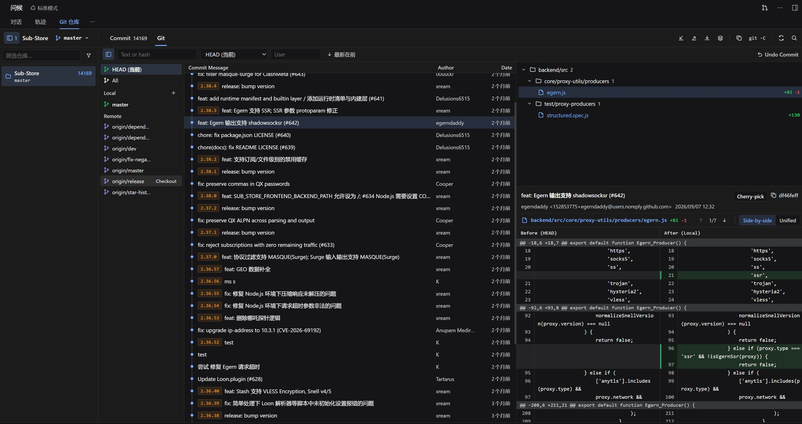

<div align="center">
  
  <h1>DSH RepoRadar</h1>
  <p>
    <strong>面向 DeepSeek Harness (DSH) 的仿 IntelliJ IDEA 多仓库 Git 工作台插件</strong>
  </p>
  <p>
    <a href="./README.md">English</a> · <a href="./README.zh-CN.md">简体中文</a> ·
    <a href="https://github.com/xxll569/dsh-repo-radar/releases">Releases 下载</a> ·
    <a href="https://github.com/xxll569/dsh-repo-radar/issues">问题反馈</a>
  </p>
  <p>
    
    
    
  </p>
</div>

---

**DeepSeek Harness (DSH)** 默认仅检测工作区根目录是否存在 `.git`。在实际项目中，真实的代码仓库往往位于多层子目录（例如 `代码/backend/`、`代码/frontend/`、`参考系统/`），或者一个工作区同时包含多个独立服务、Submodule 与 Worktree，导致原生界面无法识别或集中管理。

**DSH RepoRadar**（`dsh-repo-radar`）会自动穿透扫描工作区子目录，探测出所有 Git 仓库，并在 DSH 会话顶部视图栏嵌入一套 **IntelliJ IDEA New UI** 风格的 Git 工作台——支持目录树勾选提交、并排 Diff、三栏式 Git 日志、分支与 Stash 管理，并同步向 AI 提供 `multi_git` 工具。

<p align="center">
  
</p>

---

## 核心功能

- **多仓库与深层子目录自动发现**
  - 自动探测根目录仓库、嵌套子目录仓库、上层父仓库、Git Submodule 与 Worktree（默认扫描深度 `6`），自动跳过 `node_modules`、`target`、`dist`、`.git` 等大目录。
  - 双层刷新机制：切回标签页或 AI 每轮回答结束后自动轻量刷新状态，也支持一键重新扫描目录结构。
  - 多仓库时支持顶栏一键 **全部 Fetch**（并发执行 `git fetch --all --prune`）。
- **IntelliJ IDEA New UI 风格工具窗口**
  - **Repositories 侧边栏**：可折叠的平铺仓库列表，支持名称/分支搜索与「仅看有变更」筛选。
  - **Commit（变更提交）页**：
    - 压缩目录树（类似 IDEA *Compact Middle Packages*）与三态复选框，采用 IDEA 经典文件状态配色（修改蓝、新增/暂存绿、删除灰+删除线、未跟踪琥珀棕、冲突红），支持目录树 / 平铺切换。
    - 勾选即提交：支持 **Commit**、**Commit and Push...（提交并推送）**、**Amend（修补上次提交）**，以及批量/单文件 **Rollback（回滚）**（带二次确认）。
  - **Diff 对比视图**：
    - 支持 **Side-by-side（并排对比）** 与 **Unified（统一视图）** 切换，带 3px 左侧行号变更色条、`+N -M` 统计与 `↑` / `↓` 变更块快速跳转。
  - **Git 日志页（经典三栏）**：
    - 左栏 **Branches 分支树**（`HEAD`、`All`、`Local`、`Remote`），点击直接过滤日志，悬停快速 `Checkout`，支持 `+` 新建分支。
    - 中栏 **单行提交表**：提交图谱连线、彩色分支/Tag 旗标（`HEAD` 绿、本地蓝、远程紫、Tag 琥珀），支持按文本或 **Commit Hash** 搜索、按作者筛选、排序切换、分页加载（`加载更多`）与 **Undo Commit**（`git reset --soft HEAD~1`，保留全部修改）。
    - 右栏 **提交检查器**：上方以目录树展示本次提交修改的文件及 `+N -M` 统计，支持 **Cherry-pick** 与复制 Hash，下方联动预览选中文件的 Diff。
  - **头部快捷浮层**：
    - 分支管理浮层（新建、切换、合并、删除本地分支、检出远程分支、复制远端地址）。
    - **Stash 储藏**浮层（保存改动、Apply、Pop、Drop）。
- **共享 `multi_git` Agent 工具**
  - 将上述多仓库扫描、日志、Diff 与安全 Git 操作暴露给 DSH 会话中的 AI 助手调用。

---

## 插件安装教程

### 环境准备

- 已安装 **DeepSeek Harness (DSH)**（CLI、Web 或桌面端）
- 系统 `PATH` 中已安装并可执行 **`git`**

### 方式一：使用 `dsh` 命令直接安装（一条命令，无需手动 clone）

如果你使用的是 `dsh` CLI（如 `web`、`tui`、`headless`、`sdk` 或自定义 profile），可直接通过 GitHub 地址安装：

```bash
# 直接从 GitHub 安装到 web profile
dsh plugin --profile web add https://github.com/xxll569/dsh-repo-radar.git

# 或指定安装 v1.0.0 Release 标签版本
dsh plugin --profile web add https://github.com/xxll569/dsh-repo-radar.git#v1.0.0
```

> **DSH 桌面端（Desktop）提示**：通过 npm 全局安装的普通 `dsh` 命令不允许管理 `desktop` profile；请使用桌面端自带的 `dsh` 命令（需先打开一次桌面端初始化并完全退出后执行）：
> ```bash
> dsh plugin --profile desktop add https://github.com/xxll569/dsh-repo-radar.git
> ```
> 如果不想退出桌面端，直接用下面的 **方式二** 或 **方式三** 会更省事。

### 方式二：在 DSH 对话中一句话让助手安装

如果当前会话启用了插件管理工具（`plugin_manager`），直接在对话框发送：

> *“请帮我安装 DSH 插件：`https://github.com/xxll569/dsh-repo-radar.git`”*

（如果已手动克隆到本地，也可以直接发本地目录路径。）安装完成后**重启一次 DSH** 即可生效。

### 方式三：通过 DSH 图形界面安装（Git 地址或本地目录）

1. 打开 **DeepSeek Harness** → 进入 **插件管理（Plugins）** → 点击 **添加插件（Add plugin）**。
2. 直接填入 Git 地址 `https://github.com/xxll569/dsh-repo-radar.git`（或从 [Releases 页面](https://github.com/xxll569/dsh-repo-radar/releases) 下载压缩包解压 / `git clone` 后选择本地 `dsh-repo-radar` 目录）。
3. 确认插件列表出现 **`DSH RepoRadar · 多 Git 仓库工作台`** 且处于 **已启用** 状态。
4. **重启一次 DSH**（因为本插件注册了 Host 侧 `/api/multi-git.*` 路由与 `multi_git` 工具），进入任意会话即可在顶部视图栏点击 **`Git 仓库`**（`Git repos`）使用。

### 更新与卸载

- **更新插件**：
  - 通过 GitHub 地址安装的：移除后重新添加最新地址/标签，或执行 `dsh plugin --profile <name> update dsh-repo-radar`，再重启 DSH。
  - 通过本地目录链接安装的：在目录内执行 `git pull`，再重启 DSH 即可。
- **停用 / 卸载**：
  - 执行 `dsh plugin --profile <name> remove dsh-repo-radar`，或在 DSH **插件管理**中关闭/移除 **`dsh-repo-radar`**。停用后会自动移除 `Git 仓库` 标签页与 `multi_git` 工具，不会改动你的任何业务仓库。

---

## 项目结构

```text
dsh-repo-radar/
├── package.json       # DSH Bundle 清单与 SEO 元数据
├── cordis.patch.yml   # Cordis 插件挂载配置
├── index.js           # Host 插件：注册 /api/multi-git.* 路由与 multi_git 工具
├── git-scanner.js     # 非交互式 git 执行器、子目录扫描与状态/日志/Diff 解析
├── client.js          # Web 视图插件（conversation.view 插槽，IDEA New UI 风格）
├── icon.svg           # 插件矢量图标（36x36 SVG）
├── docs/              # 详情页图文与预览图
└── locale/            # 插件中英文标题与介绍（zh.json / en.json）
```

## 安全说明

- 所有 `git` 命令均在本地以非交互模式（`GIT_TERMINAL_PROMPT=0`、`GIT_OPTIONAL_LOCKS=0`）通过 `execFile` / `spawn` 执行，不经由 shell 字符串拼接。
- 严格校验仓库路径归属与文件路径边界，防止路径穿越。

## 开源协议

[MIT](./LICENSE)
